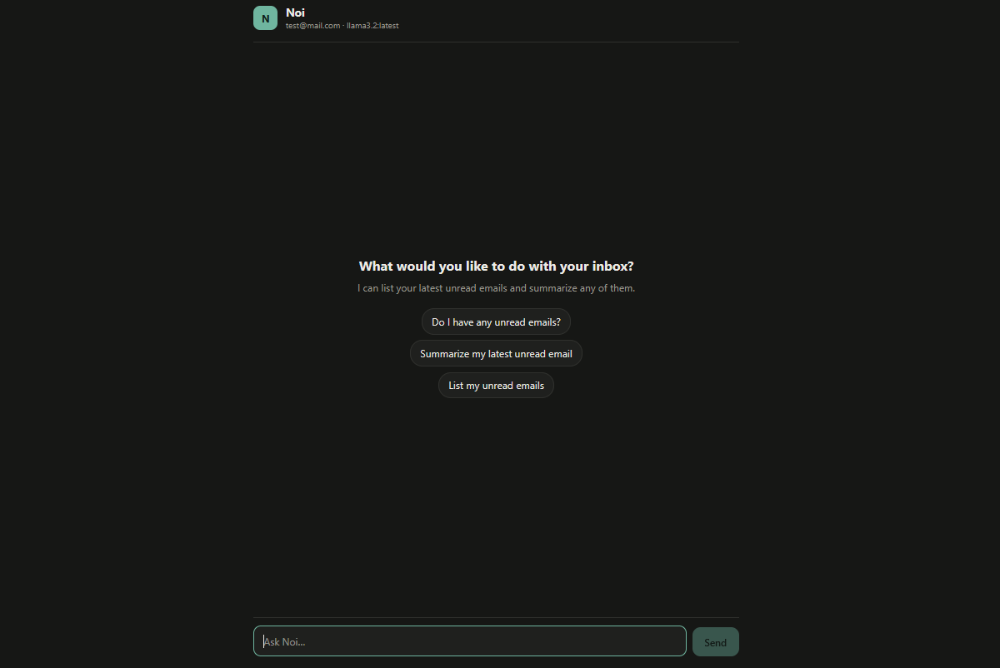

# Noi
Noi - chat your INBOX !

## About
Noi is mail assistant which allow to interact with your inbox via chatting interface with Llama3.2

## Stack
- Python - programming language
- FastAPI - web framework
- Langchain - LLM framework
- Langgraph - AI agent framework
- React JS - user interface library for JS
- Vite - JS runtime build tool

## Installation
1. Download github repository
2. Edit backend config `.env.default` file for your mail credentials (ex. Gmail) and rename it to `.env`
3. [IMPORTANT] Edit frontend `.env.default` file to establish with backend server. In case docker container deployment use `http://mail:7689` for `VITE_BACKEND_URL` variable than rename it to `.env`.

## Deployment
- Run application:

    1 Local deployment:
    - first use `setup-backend.sh` script to launch backend application
    - than call `setup-frontend.sh` script to launch fronend application
    
    2 Docker deployment:
    - make sure in `./frontend/.env.default` `VITE_BACKEND_URL` is `http://mail:7689`
    - run `docker-compose up -d`

